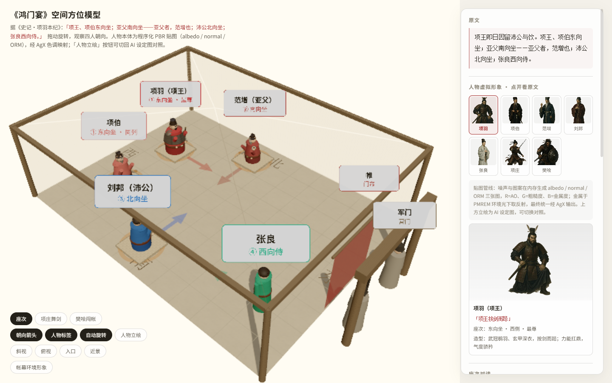
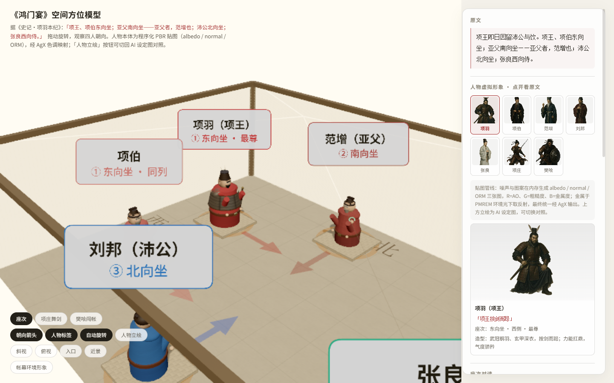
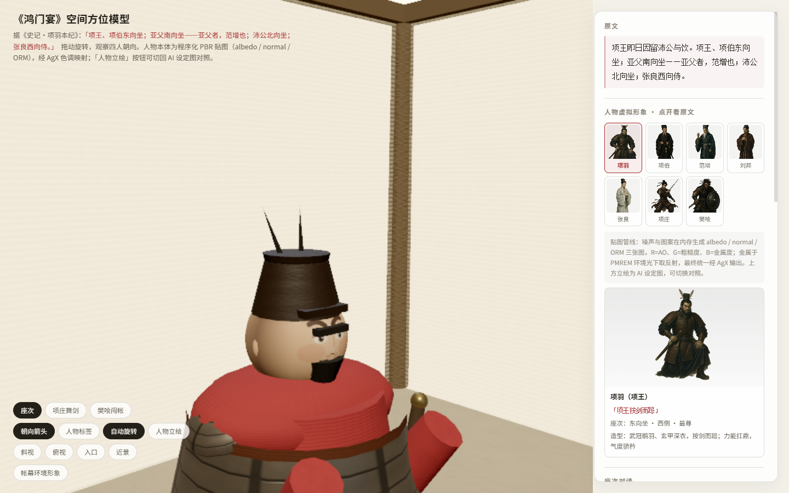
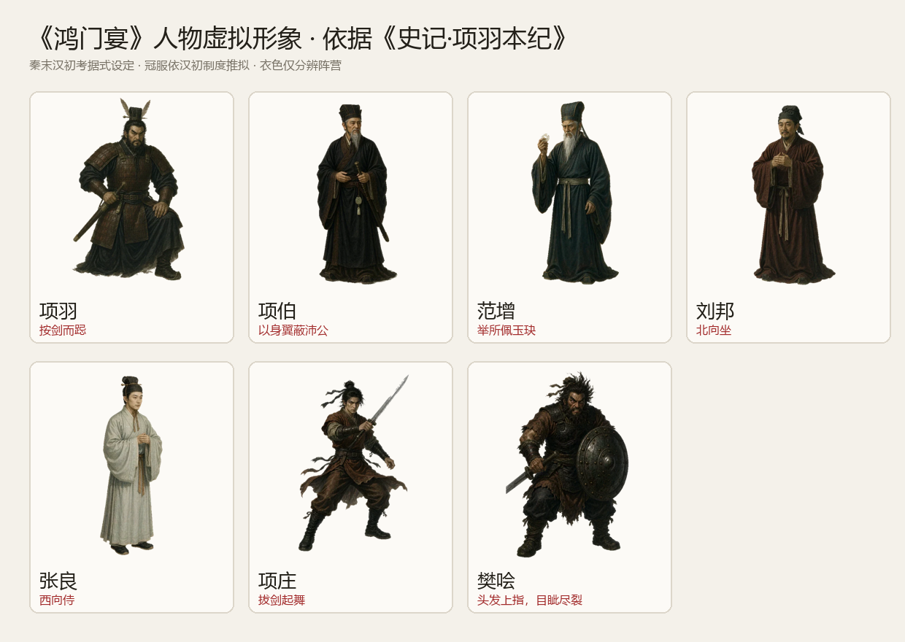

# 《鸿门宴》空间方位与人物模型

据《史记·项羽本纪》制作的单文件 3D 教学模型：可旋转查看项王、项伯、范增、沛公、张良的座次方位，并切换「项庄舞剑」「樊哙闯帐」两个叙事场景。

在线访问：<https://zhshy.github.io/hongmenyan/>

## 功能

- 三场景：座次 / 项庄舞剑 / 樊哙闯帐
- 座次方位：东向坐（最尊）→ 南向 → 北向 → 西向侍
- 人物：程序化 PBR 贴图（albedo / normal / ORM），可一键切换 AI 立绘对照
- 人物图鉴：七人原文、座次、造型依据
- 近景视角、朝向箭头、自动旋转、手机竖屏适配
- 无 WebGL 时降级为图文座次表，仍可阅读原文与人物形象

## 技术

- three.js r128（内联，离线可用）
- 自定义 AgX 后处理（与 three 的 `AgXToneMapping` 同一条曲线）
- 程序化 PBR：噪声与图案逐像素生成 albedo / ORM（R=AO、G=粗糙度、B=金属度）/ 法线
- 人物脸部为 Canvas 球面 UV 贴图；金属与皮革使用 PMREM 程序化环境反射
- AI 立绘与环境图以 WebP base64 内联，单文件约 1.4 MB

## 原文依据

> 项王即日因留沛公与饮。项王、项伯东向坐；亚父南向坐——亚父者，范增也；沛公北向坐；张良西向侍。

冠服依汉初制度推拟，衣色仅用于分辨阵营，不作史实主张。模型为便于观察省略帐顶，四壁半透明。

## 截图

## 本地打开

下载 `index.html`，双击用 Chrome / Edge 打开即可，无需服务器与网络。

## 说明

- 人物立绘与环境图为 AI 生成，仅作教学氛围参考。
- 3D 人物为程序化贴图重建，不是把 2D 立绘直接贴到模型上。
- 座次依通行注本「室内座次以东向为尊」；另有学者对军帐中东向必尊持异议，页面内已注明。
